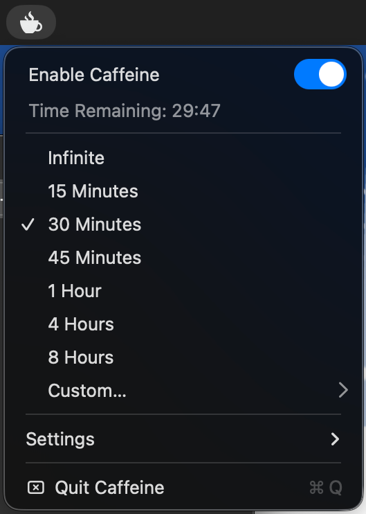

# Caffeine

### Caffeinate your Mac

Caffeine is yet another caffeination application for macOS.
Unlike most other caffeinators, this one is harder to activate and deactivate — you have to left-click the icon in your menu bar to get access to the toggle. This makes it so that you don't ever accidentally turn the caffeination on or off.



---

### Features

There are prebuilt options from 15 minutes to 8 hours; you can alternatively also set a custom duration from 1 minute to 24 hours.
You can configure the app to keep on working after your battery percentage goes below 20%. By default, it is configured to **not** do this in order to save power.

**Note:** all settings and the selected time duration will be reset to their defaults upon relaunch. This is because the app is meant to be disposable and temporary.

---

### Building

Requires Xcode Command Line Tools (for `swift`). Packaging a DMG via `sh scripts/create-dmg.sh` additionally needs the [`create-dmg`](https://github.com/sindresorhus/create-dmg) CLI (`npm install -g create-dmg`).

```
sh scripts/build-app.sh

open build/Caffeine.app
```

### Autostart (optional)

Launching with the environment variable `CAFFEINE_AUTOSTART=1` starts Caffeine already activated:

```
CAFFEINE_AUTOSTART=1 build/Caffeine.app/Contents/MacOS/Caffeine
```

---

### License


#### [MIT](LICENSE)